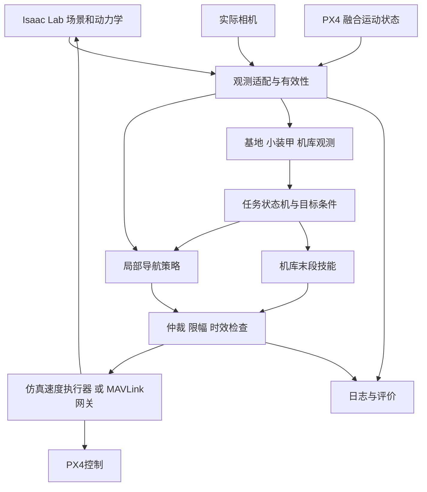

# v1.2 系统架构与接口

2026-10-11。[需求](01_PROJECT_DESIGN.md)定义范围。P0已实现并单测速度解码、ENU/NED、时效和epoch合同；其余模块仍为拟实现接口，未验证飞行。见[当前核查报告](../reports/p0/P0_ENVIRONMENT_REPORT.md)。

## 分层与数据流

只有网关/仿真执行器对外发动作；策略没有解锁、改参数、改模式权限。机库与导航技能可以分别验证，不承诺首版共用一个大网络。监督器和状态机是小而明确的必要组件，不构建通用分布式框架。

## 训练架构

Isaac Lab负责物理、渲染、重置和向量环境；一个兼容的成熟PPO库负责训练。NavRL按观测/奖励/动作/场景随机化逐项核查后择需移植。训练包导入Isaac/Torch；contracts与runtime不导入Isaac。DiffPhysDrone在隔离参考目录做原版对照，只有证明收益的模块才进入主包。

训练动作统一4维、范围[-1,1]：机体水平FLU朝向下的前/左速度、向上速度、逆时针偏航率。速度在水平航向框架定义，不随机体滚转/俯仰倾斜。转为本地ENU的物理单位指令后执行；PX4网关再ENU→NED。策略频率建议20Hz；相机/状态可异步到达，观测适配器采用最新有效样本并记录年龄，禁止无限队列。

## 核心合同（拟实现）

| 类型 | 最小字段 | 所有者与用途 |
| --- | --- | --- |
| Frame | camera_id, seq, capture_time_ns, receive_time_ns, clock_id, image, calibration_id | capture；标明采集时刻与接收时刻 |
| VehicleState | sample_time_ns, frame_id, attitude_xyzw, velocity_enu_mps, range_down_m, validity, origin_epoch | state_adapter；无效项不能填零伪装有效 |
| TaskCondition | task_mode, own_team, target_direction, target_valid, mission_epoch | mission；方向来源需记录 |
| Observation | schema_id, image_or_features, state_vector, validity_mask, ages_s, task_condition | observations；actor允许字段白名单 |
| PolicyOutput | normalized_action[4], next_hidden_state | policy；归一化输出，无直接飞控权限 |
| VelocityCommand | velocity_enu_mps[3], yaw_rate_rad_s, created_ns, valid_until_ns, mission_epoch, source, origin_epoch, clock_id, schema_id | runtime；绝对到期时间不可因重发延长；按origin与时钟域拒绝旧动作 |
| TargetObservation | class_id, team, confidence, parent_id, pixel_roi, relative_geometry, geometry_valid, time_ns | perception；基地框不自动等于精确位姿 |
| EpisodeResult | seed, scenario_id, success, collision, timeout, abort_reason, duration_s, minimum_clearance_m | evaluation；分母和原因保留 |
| ModelManifest | schema_id, action_spec, preprocessing_id, frame_spec, weights_sha256, training_config_sha256, supported_runtime | models；部署前匹配合同 |

P0确认具体dtype/库类型，标准库合同不携带GPU对象；批量张量包装放sim/observations。target_direction统一为水平机体FLU框架下的三维单位方向，零距离和缺失目标通过独立有效性字段处理；适配器记录其来源、采样时刻及坐标转换依据。相机时钟与主机时钟通过明确转换估计年龄；无法转换时记录unknown并采用已验证的接收年龄策略，不能声称capture-to-action已测得。

## 动作与时钟合同

`decode_action(action, yaw_rad, limits, now_ns, mission_epoch) -> VelocityCommand`：先拒绝NaN/Inf，验证维度，对有限值限幅；旋转机体水平速度到本地ENU。ENU→NED为[vy,vx,-vz]，偏航率取负。MAVLink SET_POSITION_TARGET_LOCAL_NED采用frame=1、type_mask=1479(0x5C7)，保留速度与yaw_rate；在P5针对锁定固件回归，不把字段正确当成闭环通过。

水平速度限值约束二维向量模长：对归一化前/左分量先投影到单位圆，再乘水平速度上限；不能仅分别裁剪两个分量而使对角线速度超限。垂直速度与偏航率分别缩放。

初值PROPOSED：20Hz策略，50Hz网关，150ms命令TTL。判过期为now_ns >= valid_until_ns。模拟延迟在单调仿真时钟中处理，实机使用单调主机时钟；禁止直接混用UTC、PX4 boot time和模拟时间。更改频率/TTL需重验停止距离与时效。

`select_action(command, state, mission_epoch, now_ns) -> Decision`返回ALLOW/REJECT及reason；失效时不得继续发送过期动作。零速度不是所有估计失效下的安全保证，具体失效动作由PX4模式、RC接管和实测配置决定。

## 状态与模式

任务主状态：IDLE→TAKEOFF→TRANSIT→BASE_ACQUIRE→ARMOR_ALIGN→TASK_EXECUTE→RETURN→DOCK_ACQUIRE→DESCEND→COMPLETE。任何状态可进入ABORT；恢复需要新鲜有效观测和明确重入条件。先实现IDLE/TRANSIT/COMPLETE/ABORT，后续增加，不先写空技能。

DETECT/APPROACH与最终任务动作分别判定；未知阵营、过期小装甲、父基地不一致不得进入TASK_EXECUTE。own_team只在任务停止时切换，清空目标/隐藏状态、增加mission_epoch。相机/估计origin重置也使相关动作失效。

返库分为返回可见区域与末段对准两个问题。下视图像优先用于后者；若其承担持续光流则不能在巡航阶段关闭整条下视链。攻击与拦截技能互斥，同一时刻一个指令所有者。

## 观测与轻量化

P2理想几何/距离观测只作基线；P3候选A为RGB+融合运动状态，候选B在A基础上增加明确模拟的有限前向距离观测。深度oracle作参考，不计入A/B部署能力。输入图像分辨率、CNN宽度、是否GRU由消融及设备实测选择。

目标识别可复用同一相机的原始图像ROI，不能把远距小装甲也无条件压成导航分辨率。原始IMU、原始光流、融合速度不默认重复输入。策略与识别按任务需要调度，CPU/内存/延迟按同时运行的最坏任务阶段评估。

## 部署与可观测性

导出仅包含actor与必要隐藏状态，预处理、归一化、动作缩放和GRU reset契约随模型发布。ONNX是候选交换格式，后端依据实际ARM/CPU支持选择；先验证FP32数值及闭环，再比较量化。训练器、critic、Isaac和优化器不进入机载包。

日志关联frame_seq、state_seq、obs_seq、action_seq、mission_epoch、model_hash和时间；原始视频与控制日志分文件，通过manifest关联。统计掉帧、估计失效、动作拒绝和模型耗时，错误日志有界，避免阻塞控制。
