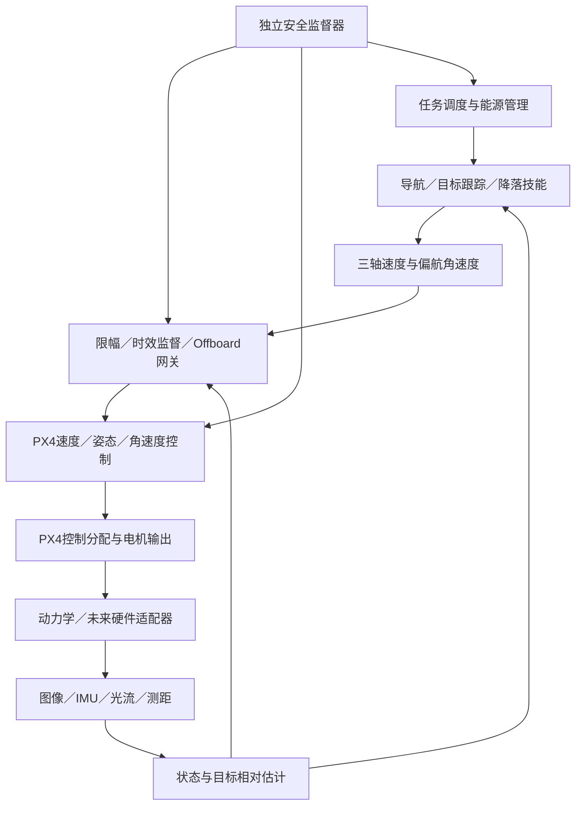

# 项目设计总览

版本：0.2；日期：2026-10-09；状态：PX4底层保留为用户确定的约束，速度接口为本轮设计选择，研究参数仍为PROPOSED。工作区路径为 `E:\isaac\proj_boom_birds`。

## 1. 目标与成功定义

建立能重复训练、独立评估和逐步替换真实参数的微型四旋翼研究平台，研究自主起飞、飞行、感知避障、目标检测跟踪、侦察、返库降落、数据卸载和能源循环。最终形成可向 Raspberry Pi 5 与飞控移植的策略及接口证据。

项目成功不以“一个仿真动画能飞”为标准，应能回答：任务在哪些条件下成功，失败来自哪一层，策略比参考控制器改善什么，换成真实传感器、时延、推力限制后是否仍然成立。

当前阶段交付范围为 Windows 上的建模、训练、仿真及离线评估。真实安装、刷写、连接和飞行属于另行设计的硬件阶段。原 Boom_Birds 工程继续独立开发。

## 2. 需求分解

| ID | 能力 | 主要证据 | 关键前置条件 |
| --- | --- | --- | --- |
| R01 | 起飞、悬停、移动、降落 | 状态曲线、误差、饱和、接地与失败记录 | 动力模型、控制基线 |
| R02 | 感知与避障 | 未见场景碰撞率、观测时延、丢失处置 | 前向感知、完整碰撞外廓 |
| R03 | 目标检测跟踪与侦察 | 检出／误检、轨迹误差、信息采集完整性 | 目标数据和相对估计 |
| R04 | 返库与平台降落 | 捕获率、失锁恢复、落点及接地速度 | 可部署定位、机库几何 |
| R05 | 卸载与能源循环 | 卸载校验、充电状态、连续任务统计 | 机库事件模型、能源估计 |
| R06 | 安全与失效收尾 | 故障注入矩阵及独立安全动作 | 有效性、时钟、超时与控制权限 |
| R07 | 可复现与迁移准备 | 训练记录、模型重载、接口一致性、推理预算 | 版本锁定与导出契约 |

资料包中的规则是2026-09-09基线快照，正式规则更新需单独核验。30秒飞行和至少10秒悬停作为继承约束配置；误差门限仍为研究提议。质量与包络约束成对检查。当前平台是否最终满足质量、功率和能源预算尚未证明。

赛事接触与拦截扩展不纳入本通用研究路线的训练目标；它们需要另行定义需求与适用边界。

## 3. 三种实现路线比较

| 方案 | 优势 | 成本与不足 | 角色 |
| --- | --- | --- | --- |
| 传统估计＋控制＋规划 | 易解释、容易建立故障定位依据 | 在复杂感知／扰动下可能需要较多人工设计 | 必须保留的基线 |
| 分层混合：学习部分控制／导航，参考内环与监督器独立 | 可逐层对比，可逐步迁移 | 需要严格维护接口和训练／部署一致性 | 推荐主线 |
| 图像到逐电机端到端策略 | 可探索联合优化 | 同时依赖视觉、动力辨识、大量训练与底层安全验证 | 不作为首轮主线 |

推荐主线首个学习对象是**相对目标到达与保持的制导策略**：输出三轴速度与偏航角速度，由PX4完成速度、姿态、角速度控制及电机分配。基础速度跟踪、定高和悬停改为PX4基线验证。传统相对目标制导器和学习策略使用相同速度接口，便于比较收益。位置接口保留给定位有效后的航点／定点技能；姿态、力矩和逐电机控制不作为首版策略接口。

## 4. 系统层次

高速训练使用单Python进程和向量化的受限飞控代理模型；真实PX4 SITL作为独立进程用于接口与策略复核。代理模型不等同PX4，早期就测量二者响应差异。Windows Isaac Lab与SITL后端之间的网络、时钟和传感器／执行器桥需要单独实现验证，不能视为现成集成。ROS 2不是核心依赖；首版采用MAVLink适配器。

## 5. 核心设计决策

| 决策 | 选择 | 理由与变更触发条件 |
| --- | --- | --- |
| 项目形式 | 独立仓库、Isaac Lab external project | 任务不写入官方仓库，环境和产物可追踪 |
| 仿真工作流 | DirectRLEnv，环境类只协调模块 | 便于逐旋翼力、时序、故障和任务状态控制；仍保持内部模块化 |
| 初始算法 | PPO，优先验证 SKRL PyTorch 适配器 | 本机已有库；必须先通过 M0，API不兼容时先解决版本组合 |
| 参考控制 | 传统相对目标制导＋PX4速度／姿态／角速度控制 | 同一飞控下比较传统制导和学习策略 |
| 部署核心 | 无 Isaac Sim／Kit 依赖的纯 Python 契约与推理逻辑 | 允许CPU测试、记录回放和ARM部署 |
| 仿真模型 | 刚体＋逐旋翼力／反扭矩＋滞后／饱和 | 默认示例直接施加自由力矩不能代表实际执行器 |
| 视觉策略 | 先感知模块输出特征，再研究学习导航 | 先建立可测量的感知误差和延迟 |
| 任务编排 | 显式状态机 | 起降、返库、卸载、能源与失效有可审计的条件 |
| 飞控选择 | 保留PX4；首版Offboard速度＋偏航角速度 | 用户确定底层方案；固件版本、板级target和参数仍需核验 |
| 仿真验证 | F0受限飞控代理用于并行训练，F1真实PX4 SITL用于复核 | 独立标注控制保真度；F0成功不能替代F1验收 |
| 环境策略 | 先复现现有栈的独立副本，再评估正式版本迁移 | 避免在架构建设时同时引入无证据的大版本升级 |

Direct 与 Manager-based 是官方提供的两类工作流；本项目选择 Direct 是针对控制与仿真时序的工程决策，不等于必须把全部逻辑写进一个环境类。[官方工作流说明](https://isaac-sim.github.io/IsaacLab/v2.3.0/source/overview/core-concepts/task_workflows.html)。

## 6. 设计交付与实施边界

本轮交付完整设计和工作区配置。实施按路线的M0到M8逐阶段建立，先交付M0／M1，再评审首任务结果。实现计划应基于本设计评审后的版本制定，不在同一天把所有目录填成空壳或虚构功能。

上线下一阶段的条件是前置证据合格，或者明确标注“假设模型研究”并限制结论。缺少实测推力不会阻止通用仿真实验，但会阻止声称策略已适用于真实机体。

范围变化写入决策记录。观测或动作语义变更需升级契约版本；任务语义变化需升级任务ID或场景集版本，不静默复用旧checkpoint。
