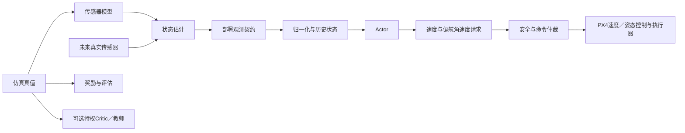
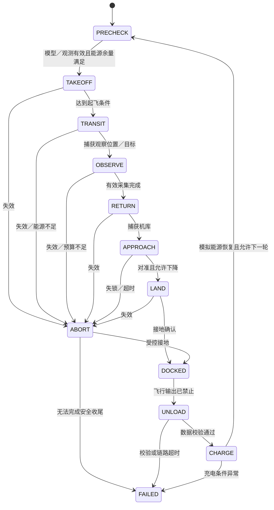

# 软件与数据架构

版本0.2。PX4保留底层控制；首版采用速度＋偏航角速度接口。下列模块及接口尚未实现，数值门限为PROPOSED。详见[接口决策](../decisions/ADR-001_PX4_OFFBOARD.md)。

## 1. 模块与依赖方向

| 模块 | 职责 | 输入／输出 | 不应承担的职责 |
| --- | --- | --- | --- |
| boom_birds_core.contracts | 数据结构、单位、坐标、schema版本 | 传感器／状态／命令／事件 | 导入Kit或启动GPU |
| core.estimation | 状态、局部里程计及目标相对估计 | SensorFrame → EstimatedState／TargetEstimate | 读取仿真真值补偿误差 |
| core.control | 传统目标制导、速度命令限幅与平滑 | TargetEstimate → VelocityYawRateCommand | 在真实部署中替换PX4速度／姿态内环 |
| core.mission | 技能编排、计时与能源决策 | 状态＋事件 → 技能及目标 | 直接访问PhysX或发电机指令 |
| core.safety | 有效性、时效、边界、失控与能源监督 | 状态／命令 → 许可／覆盖动作／故障事件 | 依赖奖励判断安全 |
| boom_birds_lab.dynamics | 刚体与逐旋翼动力的Isaac适配 | MotorCommand → 实际力／力矩 | 把策略输出当任意世界坐标力 |
| lab.sensors | 传感器仿真、采样、延迟、失效 | 仿真状态 → SensorFrame | 给actor传递隐藏的测量真值 |
| lab.autopilot | F0受限飞控代理与F1 SITL后端选择 | VelocityYawRateCommand → 执行器输出 | 将F0结果标为真实PX4结果 |
| runtime.adapters.px4 | 单写入者Offboard网关、遥测、命令时效与模式确认 | 速度命令 ↔ MAVLink／PX4 | 无限续发已过期策略命令 |
| lab.tasks | DirectRLEnv任务协调 | actor／critic观测、动作、奖励、done | 内嵌所有控制和估计算法 |
| lab.training | RL库包装、训练与checkpoint | 环境 → 模型和训练状态 | 自行改变观测顺序 |
| lab.evaluation | 固定场景、指标、失败分类 | 控制器／策略 → 报告与回放 | 使用测试结果选择模型 |
| boom_birds_runtime | 预处理、actor加载、推理、日志、适配器 | 部署观测 → 控制请求 | 携带critic或Isaac依赖 |

依赖方向：lab与runtime可依赖core；core不能依赖lab／runtime。任务可以调用控制器，但控制器不读取任务对象。可微／批处理算术由轻量后端模块承接，core包导入不能强制加载Torch、GPU或仿真器；需要Torch的实现显式导入对应模块。

## 2. 训练／部署的共同数据流

真值接口与部署接口使用不同类型和访问路径。actor观测构造函数只接收EstimatedState、任务命令和历史动作；不接收整个env、robot.data或TruthState。自动检查观测字段来源，使用毒化／屏蔽真值字段的测试验证隔离，而非只检查字段名称。

critic真值、教师动作可以用于训练，但模型选择必须基于部署观测评估。若使用蒸馏，教师和学生checkpoint分开，学生重新运行完整测试。

## 3. 三档观测保真度

| 档位 | 状态来源 | 使用场景 | 结论范围 |
| --- | --- | --- | --- |
| Oracle | 仿真真实速度、姿态等 | 动力、算法上限和回归诊断 | 仅真值条件下成立 |
| E0 Proxy | 真值经偏置、时延、滤波、漂移、丢帧代理 | M2快速研究与误差敏感性 | 估计误差假设下成立，未验证真实估计器 |
| E1 Sensor | 模拟IMU／光流／测距经实际估计代码；视觉阶段增加图像处理 | M3后部署候选训练和评估 | 给定传感器模型下成立，仍不等同实物 |

另设独立的飞控保真度：F0=受限飞控代理，F1=真实PX4 SITL。每条结果同时标注观测档位和飞控档位。F1中用于PX4速度闭环的状态来自PX4估计器；上位机负责目标／地图相对估计，并在需要时经已验证接口提供外部里程计。不能同时运行两套争夺执行器权限的底层控制器。

三档任务ID／配置和报表必须能区分。E0不得伪装为E1。真实速度无法从现有传感器可靠估计时，应缩小任务域、增加有效观测或改任务，不把真值回填为“估计值”。

## 4. 坐标、时间与契约

内部统一SI单位：m、s、kg、N、N·m、rad；世界坐标ENU／z向上，机体系FLU／x前y左z上。姿态约定 `q_wb` 为从机体到世界的主动旋转，四元数存储顺序wxyz。相机光学系单独声明，使用固定外参转换。

飞控FRD／NED等约定只在适配器边界转换，必须用基向量、90度姿态与偏航角速度测试验证。没有在适配器内验证前，不允许直接拼接控制消息。

每个消息包含schema_version、episode_id、sequence、测量时间t_sample、到达时间t_arrival、frame_id、valid。仿真使用仿真单调时钟；运行器使用单调时钟。UTC只用于文件命名与跨日志关联。重置后清空历史、滤波状态和延迟队列，禁止跨episode污染。

| 契约 | 核心字段 | 无效处理 |
| --- | --- | --- |
| SensorFrame | gyro／specific_force、flow、range、可选image引用及各自时间／有效性 | 丢失和无效分别标注；不以0当作有效量测 |
| EstimatedState | 姿态／速度／高度、局部位姿可选、协方差、有效性与年龄 | 估计器预测有限时长；超时触发监督 |
| TargetEstimate | 相对位置／方向、坐标系、置信度、跟踪ID、可见性与年龄 | 丢失后限时保持或进入重捕获 |
| FlightCommand | 技能模式、相对目标、有效截止时间 | 目标更新与模式切换经过仲裁 |
| VelocityYawRateCommand | 本地ENU三轴速度、偏航角速度、序列号和有效截止时间 | 有界速度／加速度／角速度，拒绝过期及非有限值 |
| AutopilotStatus | 模式、解锁状态、估计有效性、遥测年龄、故障与命令确认 | 模式请求已发出不等于切换成功 |
| MotorCommand | motor_order、4路执行器输出及映射版本 | 仅飞控／代理到物理模型的内部接口，不是actor动作 |
| EnergyEstimate | 当前可用能量估计、返库成本、余量、置信度 | 不确定度过高时保守返库或禁止起飞 |
| SafetyEvent | 原因、优先级、触发时间、处置、解除条件 | 保留至满足明确恢复条件 |

动作归一化映射到固定配置的速度与偏航率限值。内层代理可使用名义控制参数，但不能借助actor或真实PX4不可得的质量、扰动、电压真值实现完美补偿。物理模型使用真实随机参数；估计与飞控只能消费声明的传感器输入。

## 5. 控制与动力学

策略输出速度和偏航角速度。F1由真实PX4计算内环与电机输出；F0用具有带宽、加速度、倾角、推力和延迟约束的代理实现，代理参数通过同一机体配置下的SITL阶跃和轨迹响应校准。禁止直接覆盖刚体速度实现“完美速度执行器”。电机输出映射和饱和必须保留，传感器／执行器桥不得同时让两套物理引擎推进同一机体。

动力模型按每个电机处理：请求 → 响应滞后 → 受电压限制的转速／推力 → 旋翼轴向力与反扭矩 → 在旋翼实际位置作用于刚体。最小模型采用 `T_i = k_f * omega_i^2`、`Q_i = direction_i * k_m * omega_i^2` 和一阶响应；系数、转向和时间常数均需来源记录。不能用KV值代替已测曲线。

CAD缺失时采用明确ASSUMED的刚体和完整桨保碰撞几何；质量、惯量、重心与旋翼位置同时配置。视觉网格与碰撞网格分离，完整外廓用于任务碰撞和降落判定。

阻力、风、近地效应、桨保相互作用逐项增加。初版若未模拟近地效应，报告中限定降落结论。能耗先用ASSUMED功率模型积分，不把奖励中的动作平方称为实际耗电量。

## 6. 调度与频率（全部为PROPOSED）

| 环节 | 初始研究频率 | 备注 |
| --- | --- | --- |
| F0物理与代理内环 | 250Hz | 与500Hz比较；真实PX4调度由锁定固件决定 |
| 制导策略／Offboard网关 | 20Hz／50Hz | 网关只在命令有效期内重发；逻辑时间与墙钟分开 |
| IMU采样 | 250Hz | 模拟频率；实机速率／延迟需测量 |
| 光流／测距 | 50Hz候选 | 来自硬件资料背景，仍须测真实到达率和失效域 |
| 图像感知／导航 | 15Hz起测 | 与物理时钟异步调度，不能每个物理步生成新视觉观测 |
| 任务管理 | 10Hz＋事件触发 | 安全监督至少每个策略周期执行，执行器层另有保护 |

未到采样时间时重复的是上一观测及其递增年龄，不制造新数据。传感器数据由采样和到达队列调度，禁止未来量测提前可见。仿真加速倍数不改变逻辑频率；真实推理延迟需独立测量。

## 7. 任务状态机与机库循环

所有活动状态都有超时和失败路径，PRECHECK失败保持禁止起飞；每次转移记录守卫条件、计时和原因。返库、接地和卸载完成分别判定。卸载采用事务ID、长度／校验和和确认消息；失败重试有上限，未确认完成不能删除机载记录。充电先是抽象事件，不宣称已有充电电路。

## 8. 安全监督与故障注入

上位机命令优先级：监督器 > 当前技能 > 学习策略；只有一个Offboard网关可以写入PX4。PX4内部模式仲裁、failsafe及独立紧急停桨属于另一层，需分别验证。保留PX4不代表任意输入和失效状态都能自动恢复。

| 故障 | 仿真测试 | 设计处置原则 |
| --- | --- | --- |
| 图像失锁／丢帧 | 遮挡、时间戳过旧、图像无效 | 减速、有限时长重捕获；持续失效转安全收尾 |
| 光流／测距失效 | 无纹理、量程外、倾角／反射条件失败 | 标记估计不可用；只在剩余估计足够时保持或下降 |
| 推理超时／NaN | 注入慢推理、异常输出 | 拒绝异常命令，有限时长使用已验证回退控制 |
| 控制链路失联 | 命令过期 | 执行预先验证的飞控侧失联策略；具体动作需结合状态能力验证 |
| 能源／时间余量不足 | 增加耗能或延长航路 | 提前返库；任务失败和安全返库分别统计 |
| 碰撞／越界／失控 | 机体接触、姿态异常、穿界 | 环境结束并归因；真实处置不从仿真done自动推导 |

“失效就悬停”不是通用回退：定位或动力失效时悬停可能不可行。M3故障矩阵必须明确哪些剩余观测支持哪种动作；未验证的组合禁止进入部署候选。
