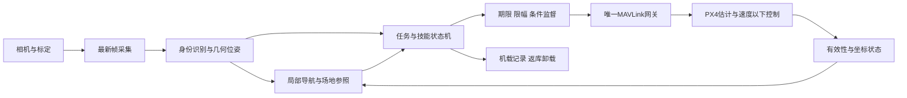

# 模块、数据与控制架构

v1.1；所有运行模块待实现。主路线见[总纲](../../PROJECT_PLAN.md)，目录见[工作区](05_WORKSPACE.md)。

## 模块责任

contracts：标准库schema/坐标/时间/epoch；capture：实际格式/帧龄和有界队列；perception：候选与身份；geometry：尺寸/关键点/双目和误差；state_adapter：质量/重置/遥测来源；navigation：局部通道与参照，不覆盖PX4内环；mission：起飞、远段、捕获、对准、任务、返库、降落；supervisor：限速/期限/回退；px4_gateway：唯一协议发送与模式确认；storage/dock：机载记录、库内卸载与充电事件；evaluation：真值对照与失败报告。学习层可选，输出同一合同。

## 数据合同（schema_version=1，待实现）

v1.1新增match_context/identity与projectile_tracker/interception_skill。目标观测携带team/confidence、observed_color、parent_base_id、ROI与地图区域；own_team在任务层统一派生敌我，基地框与小装甲关联分别评价。来袭观测另含对象类型、轨迹/不确定度、剩余时间/有效域，不能按42mm球色猜敌我。攻防技能只能经同一监督/网关仲裁，任务切换不混发；阵营配置只在未解锁/任务停止时切换并更新epoch。详情见[阵营与拦截合同](../planning/09_TARGET_TEAM_AND_INTERCEPTION.md)。

mission内skills负责传统制导：远段按已知3D通道和可信局部状态生成有界参考；近段使用相对位姿误差的限幅比例控制与速度/加速度限制，偏航率由角度误差生成。增益/限速经W02响应及W05真实误差确定，不先训练。到捕获/末段切换需身份、位姿质量、观测龄和净空连续满足任务卡；失锁先退出末段，不立即沿最后目标高速前进。动态障碍检测无覆盖或通道不可信则中止该路径，不能凭前向相机声称全方向避障。

| 类型 | 必要字段 | 接收条件 |
| --- | --- | --- |
| Frame | seq/camera_id、capture_time/clock_domain、receive_monotonic、尺寸、标定哈希、丢帧 | 最新帧；采集时钟偏移与不确定性已记录 |
| TargetObservation | id/type、来源、相对光学坐标/关键点、置信/误差、时刻、标定哈希 | 身份和几何有效分别判断；过期/歧义不沿用旧位置冒充新测量 |
| VehicleState | PX4/接收时间、姿态/速度/位置/高度、质量、mode/armed、origin_epoch/reset、来源 | 缺失有效性证据为UNKNOWN；有数值不代表有效 |
| MotionCommand | seq、issued/expires_monotonic、epoch、ENU速度、CCW yaw_rate、技能、观测seq/时间 | 非有限、超范围、旧seq/epoch/TTL、无有效速度/航向则拒绝 |
| MissionEvent | run_id/state、进入/退出原因、时间、关联输入、失败分类 | 模式请求与实际确认分开，可重放 |

期限在网关同域单调时钟执行；跨主机时刻先验证偏移及不确定性，不直接相减。重发不改变issued/expires。观测年龄包含采集、队列、处理、传输及同步误差；命令TTL不能掩盖旧图像。PX4时间通过TIMESYNC或经验证偏移建立映射，进程/飞控重启后重建。time_boot_ms不能填宿主Unix时间。

## 坐标与协议

内部ENU x东/y北/z上，仅在与PX4局部轴对齐后使用；NED=[vy,vx,-vz]，ENU逆时针偏航率转NED负号。初始航向与原点必须有来源。机体FLU→FRD=[x,-y,-z]；相机光学x右/y下/z前用实测刚体外参转换，不假设镜头水平朝前。完整姿态与仅水平航向使用不同变换函数。

SET_POSITION_TARGET_LOCAL_NED：frame=MAV_FRAME_LOCAL_NED(1)，velocity m/s与yaw_rate rad/s；忽略position、acceleration、yaw，type_mask=1479(0x5C7)。不置FORCE_SET，不屏蔽yaw_rate；忽略字段填零并测试接收语义。系统/组件ID从校验心跳识别。依据[协议](https://mavlink.io/en/messages/common.html#SET_POSITION_TARGET_LOCAL_NED)与[锁版本接收源码](https://github.com/PX4/PX4-Autopilot/blob/v1.17.0/src/modules/mavlink/mavlink_receiver.cpp)，实际支持仍须SITL证明。

HEARTBEAT确认模式/解锁；COMMAND_ACK不是模式已生效证明。LOCAL_POSITION_NED不包含完整有效性标志，结合ESTIMATOR_STATUS等所锁版本已核查的质量消息及模式检查。真实重置检测需明确ODOMETRY reset_counter或其他可靠来源和流配置；未覆盖重置不能跨场放行。S0先用合同注入测重置，真实遥测覆盖单列验收。

## 监督状态与故障

BOOT→READY（心跳/估计/时钟/配置有效）→PRESTREAM→ACTIVE（模式实际确认）→RECOVERY→LANDED/ABORT。初值策略20Hz、网关50Hz、TTL150ms均PROPOSED，按帧龄与制动预算校准。[PX4 Offboard](https://docs.px4.io/v1.17/en/flight_modes/offboard)要求连续生存流与进入前预流；候选1.5s预流是余量，不能代替确认。

策略过期但网关活：旧运动命令失效；速度及环境条件允许时有限零速并请求已验证安全模式，确认后停Offboard流。估计无效时零速/悬停无保证，走所锁固件已验收的状态依赖回退。拒绝/超时不可无限重试并续发旧命令，应按矩阵停止流并交飞控已配置Offboard-loss。网关/链路消失另测飞控自身失联。COM_OF_LOSS_T等、RC可用性与无GPS可用模式须锁定测试，无GPS不默认Return/Hold成立。

独立停桨由接收机/安全员验证，不被进程心跳代替。PX4不能为错误任务绝对保底。

## 后端边界

SIH理想定位仅证明接口，真实录制重放仅证明视觉/计算，无GPS试验增加真实估计条件。部署禁止仿真真值/GPS/额外敌方标记。后续Isaac代理训练明确标代理，晋升以真实PX4同观测复核；桥不可用保持未通过，不把代理更名为PX4。
